# Chat AI – Funktionsinventar

Version 1.0.2, Stand 31.10.2026. Diese Seite listet jede Funktion der Weboberfläche von GWDG Chat AI (Version 1.0.2) mit Beschreibung, Fundort und Screenshot. Aufgenommen wurde alles in der lokalen Demo mit simulierten Modellen und deutscher Oberfläche.

Rot umrandet ist in jedem Screenshot das Element, um das es geht.

## Inhalt

- [Kopfbereich & Modellauswahl](#kopfbereich) (13)
- [Seitenleiste: Chats & Themen](#seitenleiste) (20)
- [Unterhaltung & Antworten](#unterhaltung) (22)
- [Eingabe & Anhänge](#eingabe) (9)
- [GWDG-Werkzeuge](#werkzeuge) (8)
- [Chat-Einstellungen](#chat-einstellungen) (8)
- [Benutzereinstellungen & Gedächtnis](#benutzereinstellungen) (10)
- [Hilfen, Hinweise & Dialoge](#hilfe-hinweise) (7)
- [Fußzeile, Tour & Seiten](#rahmen) (9)

## Kopfbereich & Modellauswahl

Alles rund um die Wahl des KI-Modells und die Hinweise am oberen Rand.

### 01 Ankündigungsleiste

Ein farbiger Balken ganz oben zeigt Mitteilungen des Betreibers, etwa Wartungsfenster oder neue Modelle.

- **So erreichst du es:** Erscheint automatisch oben, wenn der Betreiber in der Konfiguration eine Ankündigung setzt. Mit dem **X** rechts schließen; nach fünfmaligem Schließen bleibt sie ausgeblendet.
- **In der Demo:** Zeigt den Hinweis, dass alle Modelle simuliert sind.
- **Code:** `front/src/components/Header/AnnouncementBar.jsx`

### 02 Modellauswahl öffnen

Öffnet die Liste aller verfügbaren Modelle, aus der man das Modell für den aktuellen Chat wählt.

- **So erreichst du es:** Unten in der Eingabeleiste auf die Schaltfläche mit dem Modellnamen tippen (**Modell wechseln**).
- **In der Demo:** Die Liste enthält die echten Namen und IDs der Academic Cloud, die Antworten sind simuliert.
- **Code:** `front/src/components/Prompt/ModelButton.jsx`

### 03 Hinweis auf die Modellübersicht

Ein Hinweis oben in der Liste verlinkt die Modellübersicht der GWDG-Dokumentation, falls man unsicher ist, welches Modell passt.

- **So erreichst du es:** In der Modellauswahl ganz oben: **Unsicher, welches Modell Sie wählen sollen? Lesen Sie die Modellübersicht.**
- **Code:** `front/src/components/Header/ModelSelectorExtended.tsx`

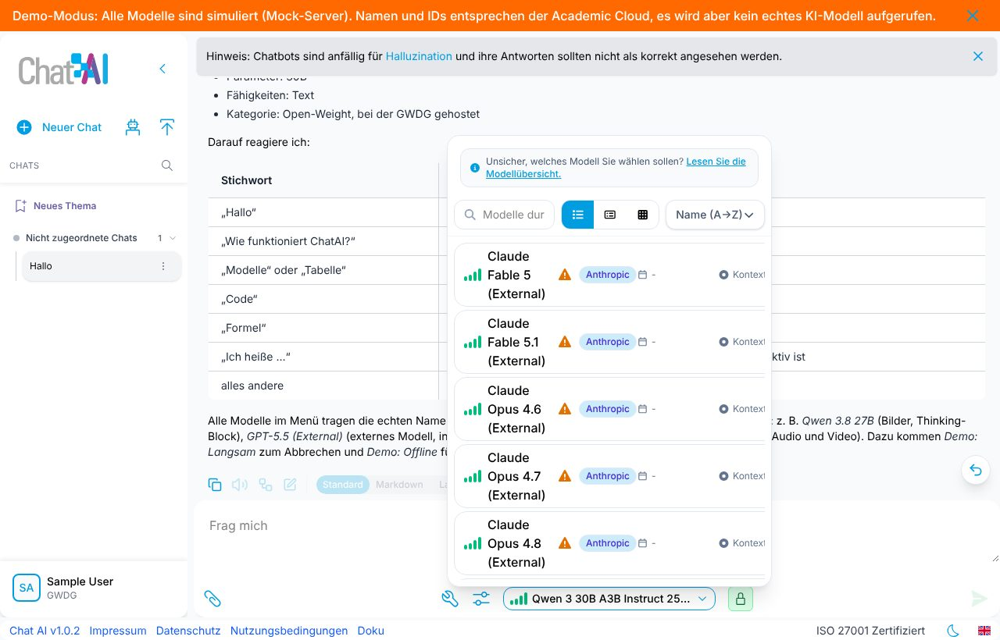

### 04 Modelle durchsuchen

Filtert die Modellliste nach Name, ID oder Fähigkeiten wie „image“.

- **So erreichst du es:** In der Modellauswahl in das Feld **Modelle durchsuchen …** tippen.
- **Code:** `front/src/components/Header/ModelSelectorExtended.tsx`

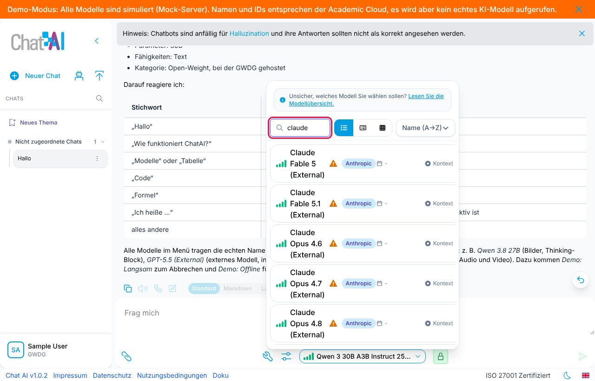

### 05 Ansichten: Liste, Erweitert, Raster

Wechselt die Darstellung der Modellliste zwischen kompakter Liste, ausführlicher Ansicht mit Beschreibung und Kachelraster.

- **So erreichst du es:** In der Modellauswahl die drei Symbole **Liste**, **Erweitert** und **Raster** neben der Suche.
- **Code:** `front/src/components/Header/ModelSelectorExtended.tsx`

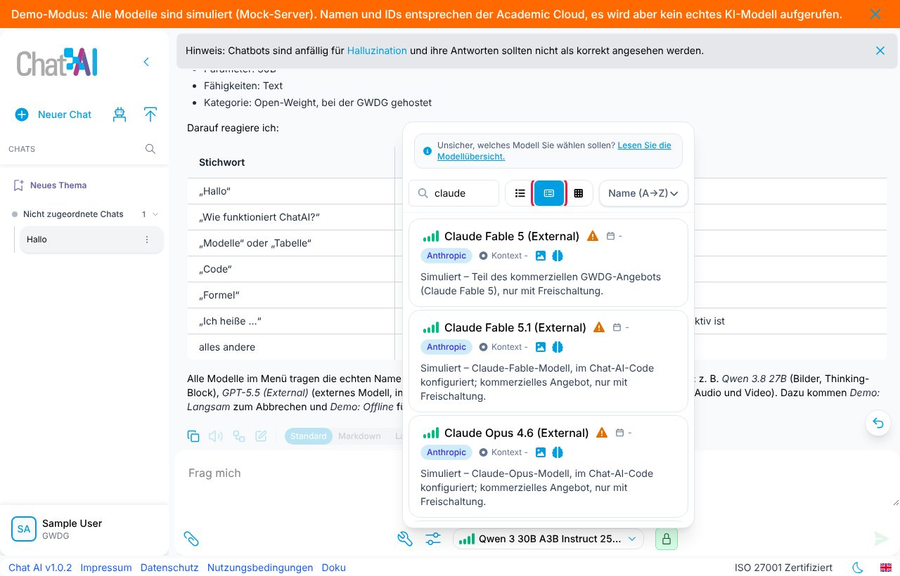

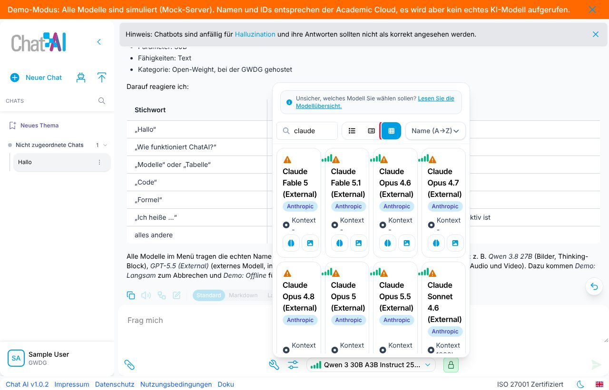

### 06 Modelle sortieren

Sortiert die Liste nach Name, Veröffentlichung, Parameterzahl oder Kontextlänge, jeweils auf- oder absteigend.

- **So erreichst du es:** In der Modellauswahl rechts auf das Menü **Sortieren nach** (zeigt z. B. „Name (A→Z)“).
- **Code:** `front/src/components/Header/ModelSelectorExtended.tsx`

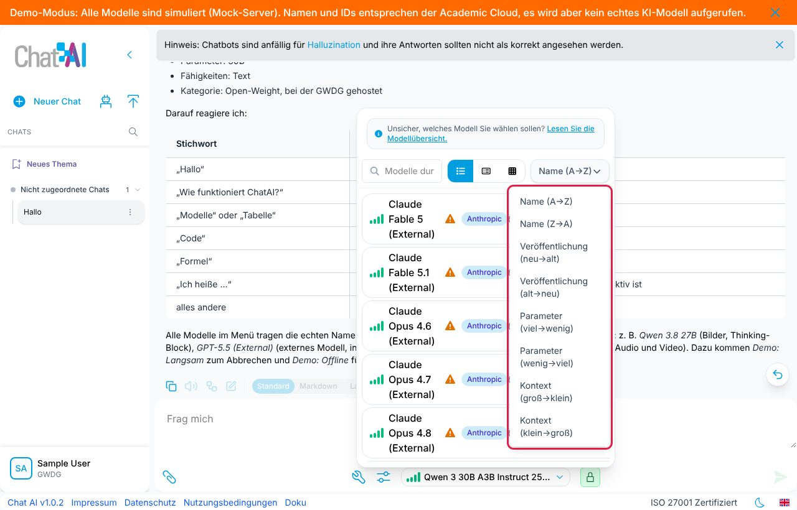

### 07 Modell-Einträge mit Auslastung und Fähigkeiten

Jeder Eintrag zeigt Balken für die aktuelle **Auslastung**, Anbieter, Veröffentlichung, **Kontext** und Symbole für **Bildeingabe**, **Videoeingabe**, **Audioeingabe** und **Denkprozess**.

- **So erreichst du es:** In der Modellauswahl; Tooltips erscheinen beim Überfahren der Symbole.
- **In der Demo:** Die Auslastung ist fest vorgegeben; **Demo: Langsam** zeigt hohe Last.
- **Code:** `front/src/components/Header/DemandIndicator.jsx`

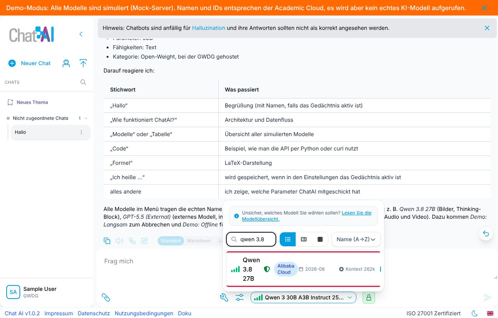

### 08 Interne und externe Modelle

Ein grünes Schild kennzeichnet Modelle, die bei der GWDG laufen; ein gelbes Warnsymbol kennzeichnet externe Modelle (z. B. OpenAI, Anthropic), bei denen Daten die GWDG verlassen.

- **So erreichst du es:** In der Modellauswahl neben dem Modellnamen (**Internes Modell** / **Externes Modell**).
- **Code:** `front/src/components/Header/ModelSelectorExtended.tsx`

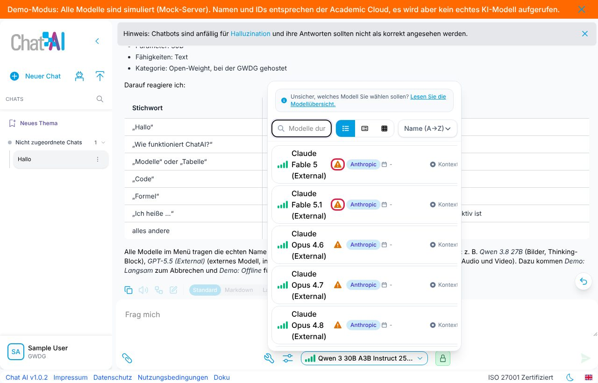

### 09 Hinweis bei Offline-Modell

Wählt man ein gerade nicht verfügbares Modell, erscheint ein Hinweisfenster.

- **So erreichst du es:** Ein Modell mit grauen Auslastungsbalken wählen; Fenster **Hinweis** mit **Ok** schließen.
- **In der Demo:** Dafür gibt es das Modell **Demo: Offline**.
- **Code:** `front/src/modals/Alert/ServiceOfflineModal.jsx`

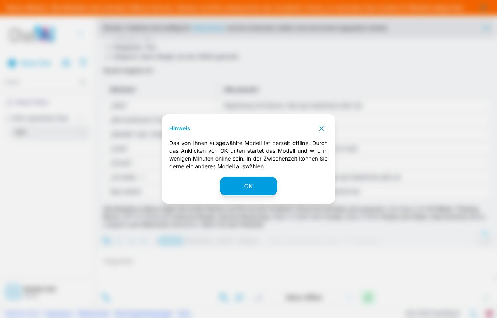

### 10 Datensicherheits-Anzeige

Ein grünes Schloss neben dem Modell bestätigt, dass die Daten innerhalb der GWDG verarbeitet werden. Ein Klick zeigt den Hinweistext.

- **So erreichst du es:** In der Eingabeleiste rechts neben der Modellauswahl auf das **Schloss** tippen.
- **Code:** `front/src/components/Header/WarningExternalModel.tsx`

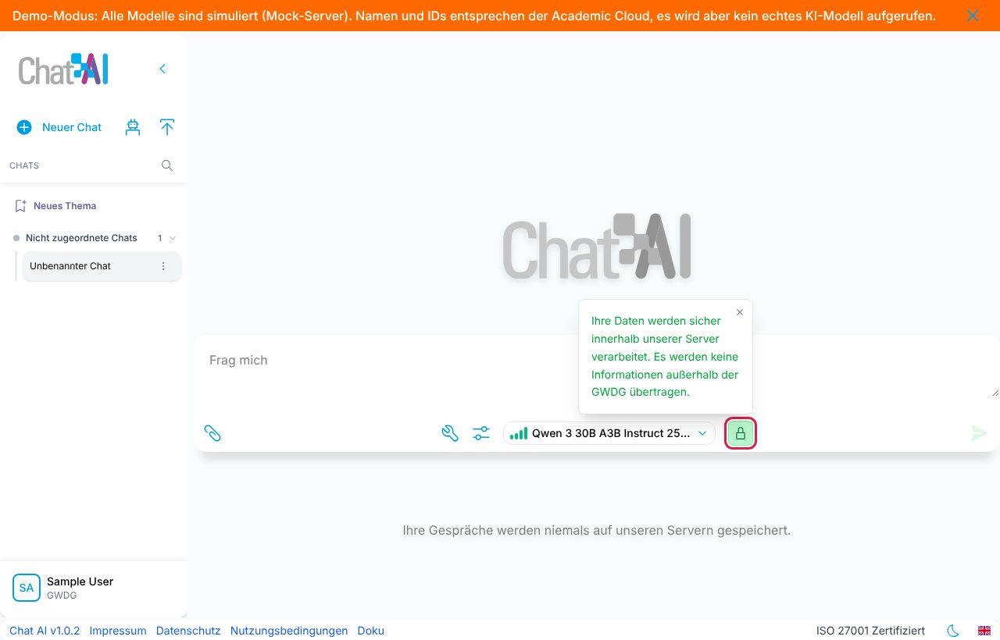

### 11 Datenschutz-Warnung

Bei externen Modellen, aktiver Websuche oder MCP-Servern wird das Schloss zum gelben Warnsymbol und ein Hinweis öffnet sich automatisch.

- **So erreichst du es:** Ein Modell mit „(External)“ wählen oder Websuche/MCP aktivieren; der Hinweis erscheint neben der Modellauswahl.
- **Code:** `front/src/components/Header/WarningExternalModel.tsx`

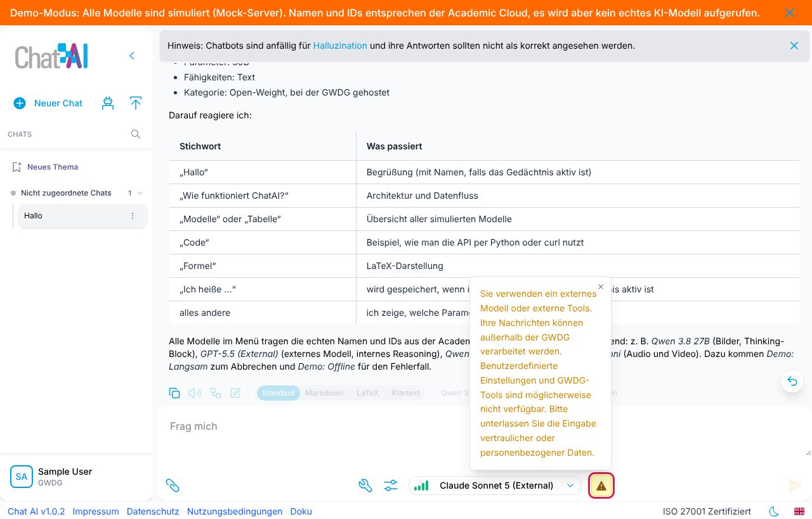

### 12 Kopfzeile auf dem Smartphone

Auf schmalen Bildschirmen wandern Menü, Logo, Modellauswahl und Datensicherheits-Anzeige in eine Kopfzeile.

- **So erreichst du es:** Unter 768 px Breite: oben links das **Menü**-Symbol, in der Mitte die Modellauswahl.
- **Code:** `front/src/components/Header/Header.tsx`

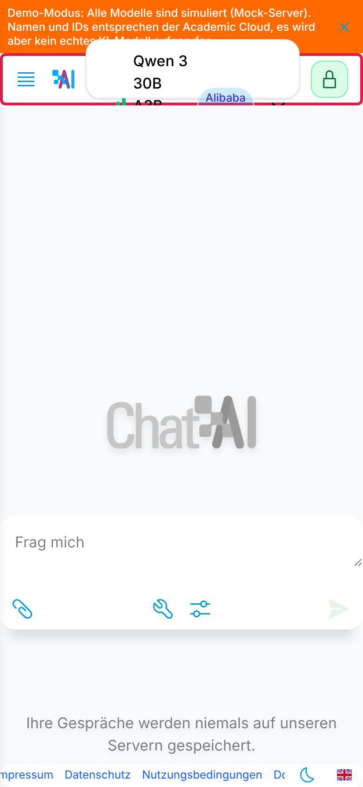

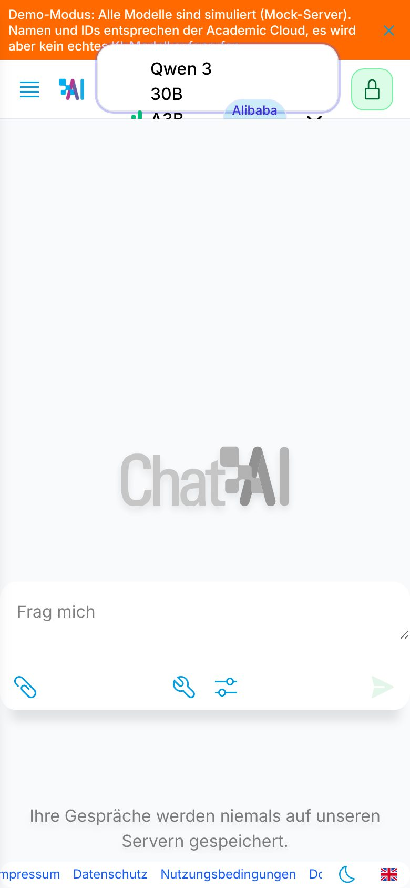

### 13 Modelle filtern

Schränkt die Liste auf **Alle Modelle**, **Nur interne** oder **Nur externe** ein.

- **So erreichst du es:** Schaltfläche **Modelle filtern** in der einfachen Modellauswahl.
- **Voraussetzung:** Nur in der einfachen Modellauswahl, die erscheint, wenn die Modelle keine Beschreibung haben. Die Demo liefert Beschreibungen und zeigt deshalb die erweiterte Auswahl.
- **Code:** `front/src/components/Header/ModelSelectorSimple.tsx`

## Seitenleiste: Chats & Themen

Chats anlegen, finden, ordnen, importieren und exportieren. Alle Chats liegen nur lokal im Browser.

### 14 Seitenleiste ein- und ausklappen

Die Seitenleiste lässt sich zu einer schmalen Symbolleiste einklappen. Diese bietet Neuer Chat, Persona, Import sowie Umbenennen, Zusammenfassen und Exportieren für den aktuellen Chat.

- **So erreichst du es:** Oben in der Seitenleiste **Seitenleiste schließen**; zum Öffnen in der schmalen Leiste **Ausklappen**.
- **Code:** `front/src/components/Sidebar/SidebarRail.tsx`

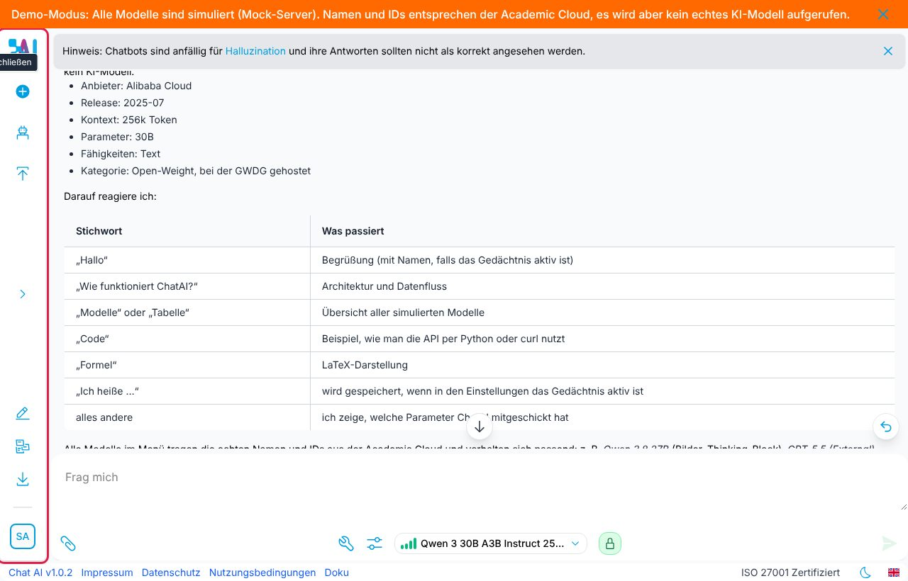

### 15 KI-Dienste-Menü

Das Logo öffnet ein Menü mit Links zu weiteren GWDG-Diensten: Image AI, Voice AI und RAG-Manager (Arcanas).

- **So erreichst du es:** Oben in der Seitenleiste auf das Chat-AI-Logo tippen (**KI-Dienste**).
- **Code:** `front/src/components/Sidebar/AiServicesMenu.tsx`

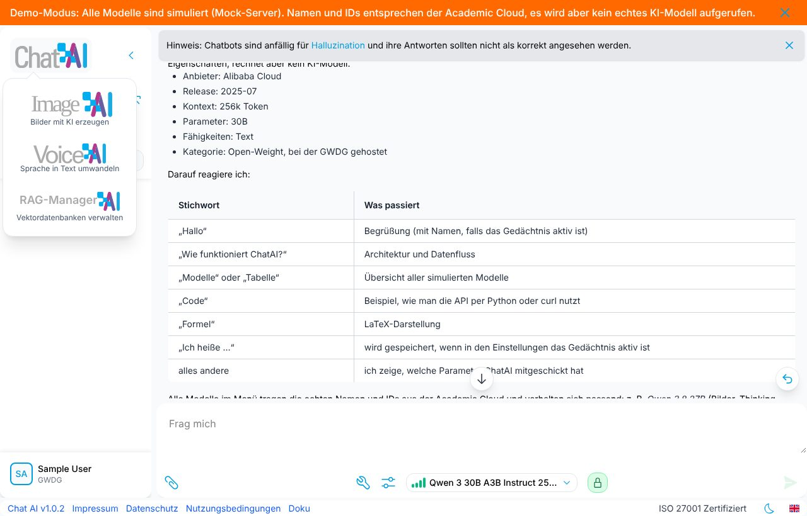

### 16 Neuer Chat

Startet eine neue, leere Unterhaltung mit dem Standardmodell.

- **So erreichst du es:** **Neuer Chat** oben in der Seitenleiste, in der schmalen Leiste oder innerhalb eines Themas; Tastenkürzel **Strg + Shift + O**.
- **Code:** `front/src/components/Sidebar/Buttons/NewChatButton.jsx`

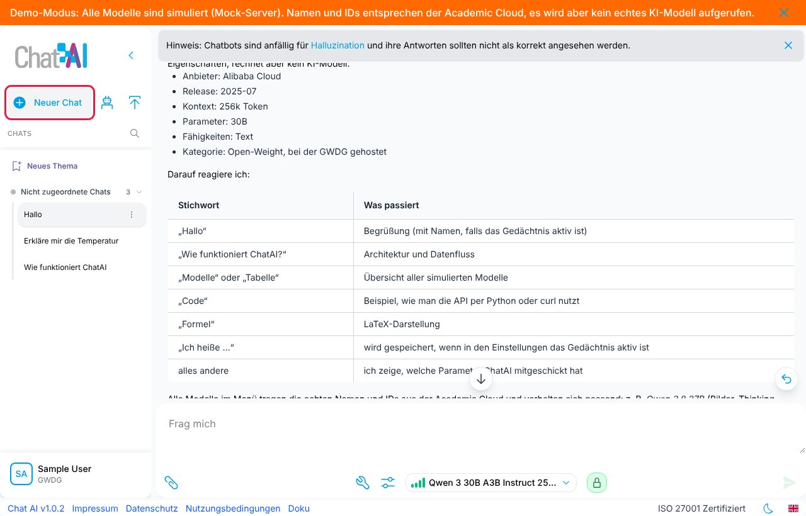

### 17 Mit Persona chatten

Öffnet die **Persona-Bibliothek** mit vorgefertigten Rollen (z. B. Tutor, Lektor). Ein Klick auf eine Persona startet einen neuen Chat mit passendem System-Prompt; eigene Personas lassen sich aus der Zwischenablage importieren.

- **So erreichst du es:** Symbol **Mit Persona chatten** neben Neuer Chat.
- **Voraussetzung:** Lädt die Personas aus dem GitHub-Repository gwdg/chat-ai-personas und braucht dafür Internetzugang.
- **In der Demo:** Die Personas lädt Chat AI live aus dem öffentlichen GitHub-Repo `gwdg/chat-ai-personas`. Ohne Internetzugang bleibt die Liste leer.
- **Code:** `front/src/components/Sidebar/Modals/ImportPersonaModal.jsx`

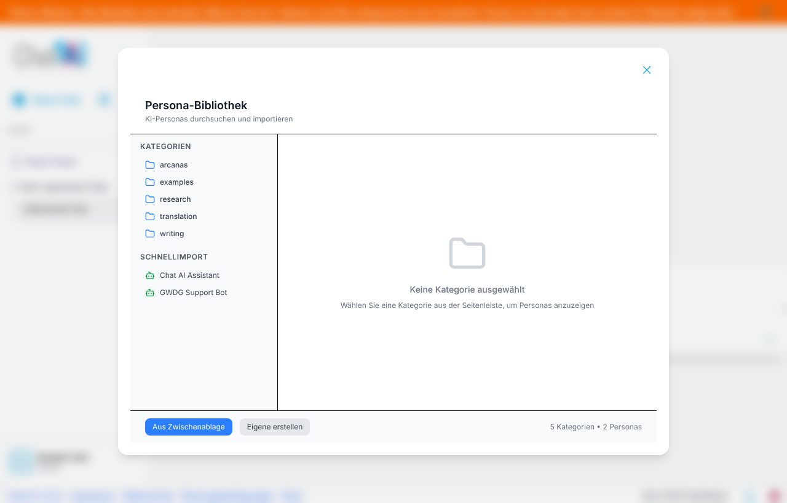

### 18 Chat importieren

Lädt einen zuvor als JSON exportierten Chat wieder in die Liste.

- **So erreichst du es:** Symbol **Chat importieren** neben Neuer Chat, dann eine JSON-Datei wählen.
- **Code:** `front/src/components/Sidebar/Buttons/ImportChatButton.jsx`

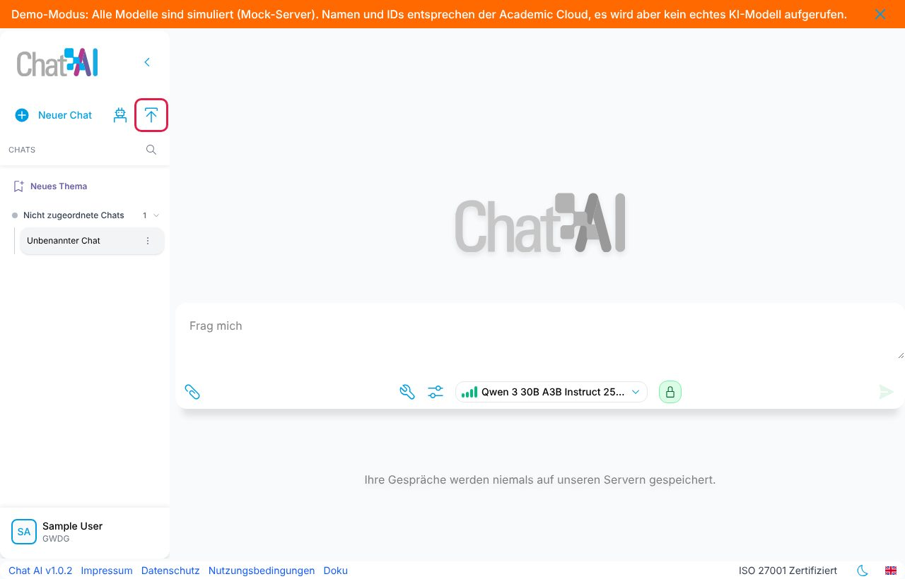

### 19 Chats durchsuchen

Durchsucht die Chat-Titel und hebt Treffer farbig hervor.

- **So erreichst du es:** Neben der Überschrift **Chats** auf die Lupe (**Suche**) tippen und im Feld **nach Titel durchsuchen** tippen.
- **Code:** `front/src/components/Sidebar/SidebarContent.tsx`

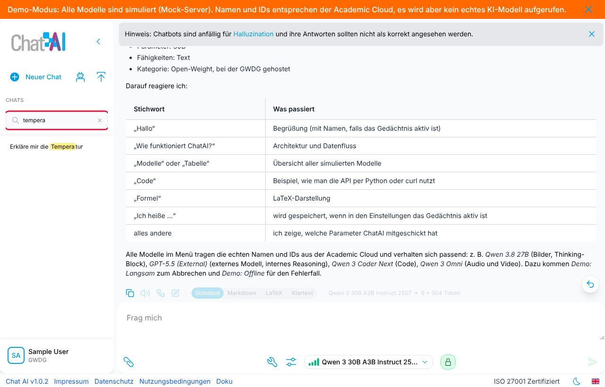

### 20 Chat-Liste

Listet alle Chats; der geöffnete ist hervorgehoben. Ein Doppelklick auf den Titel benennt ihn um, per Ziehen lässt sich ein Chat in ein Thema verschieben.

- **So erreichst du es:** Mittlerer Bereich der Seitenleiste.
- **In der Demo:** Die Titel erzeugt das simulierte Standardmodell aus den ersten Wörtern.
- **Code:** `front/src/components/Sidebar/SidebarContent.tsx`

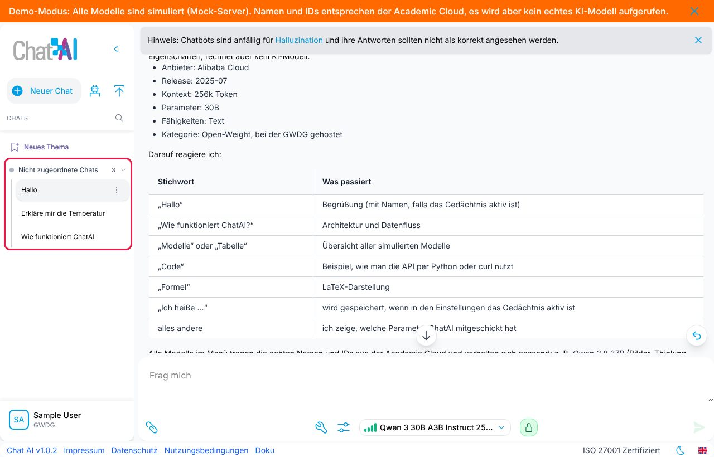

### 21 Chat-Menü

Das Drei-Punkte-Menü eines Chats bietet **Umbenennen**, **Verschieben**, **Exportieren**, **Zusammenfassen** und **Löschen**.

- **So erreichst du es:** In der Chat-Liste auf **⋮** neben dem Chat tippen.
- **Code:** `front/src/components/Sidebar/SidebarContent.tsx`

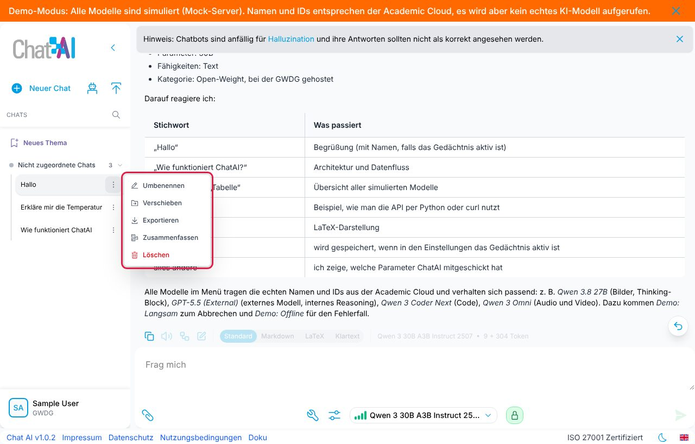

### 22 Chat umbenennen

Ändert den Titel eines Chats.

- **So erreichst du es:** Chat-Menü → **Umbenennen**, neuen Titel eingeben, **Umbenennen** bestätigen.
- **Code:** `front/src/components/Sidebar/Modals/RenameChatModal.jsx`

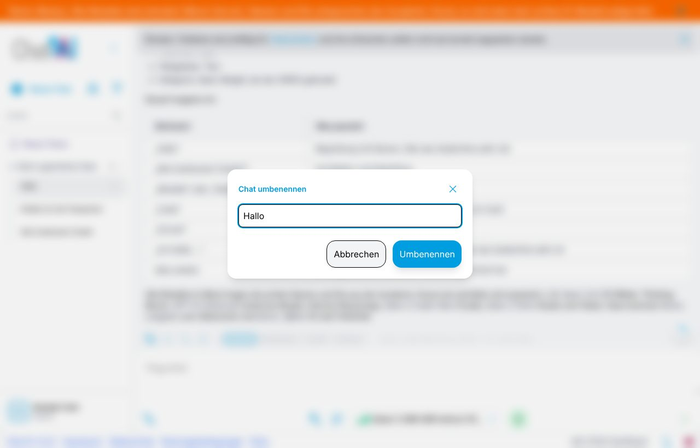

### 23 Chat in ein Thema verschieben

Ordnet einen Chat einem Thema zu; im selben Dialog lässt sich auch ein neues Thema anlegen.

- **So erreichst du es:** Chat-Menü → **Verschieben**, Thema wählen, **Verschieben**.
- **Code:** `front/src/components/Sidebar/Modals/MoveChatModal.jsx`

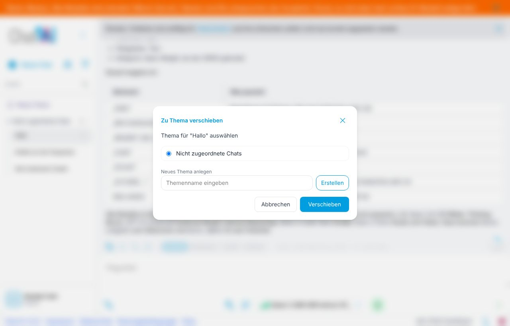

### 24 Chat exportieren

Speichert einen Chat als **JSON-Datei**, **PDF-Datei** oder **TXT-Datei**, wahlweise mit Modell, Einstellungen und Dateien.

- **So erreichst du es:** Chat-Menü → **Exportieren** oder **Chat exportieren** in der schmalen Leiste.
- **Code:** `front/src/components/Sidebar/Modals/ExportChatModal.jsx`

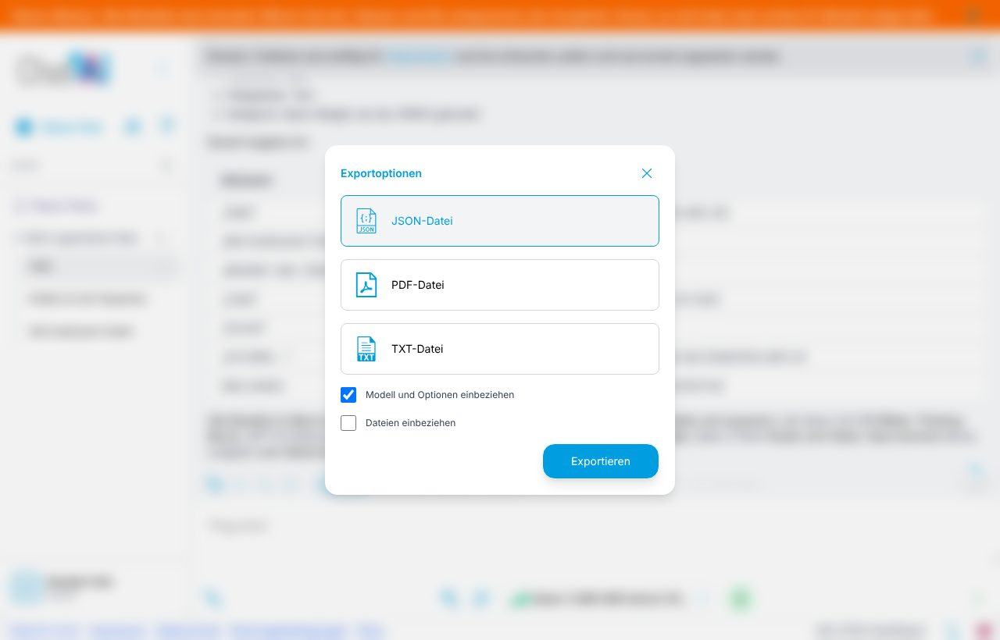

### 25 Chat zusammenfassen

Ersetzt den bisherigen Verlauf durch eine kompakte Zusammenfassung, damit lange Chats im Kontextfenster bleiben.

- **So erreichst du es:** Chat-Menü → **Zusammenfassen** (nur beim geöffneten Chat), dann bestätigen.
- **In der Demo:** Die Zusammenfassung schreibt das simulierte Modell.
- **Code:** `front/src/modals/Chat/SummarizeChatModal.jsx`

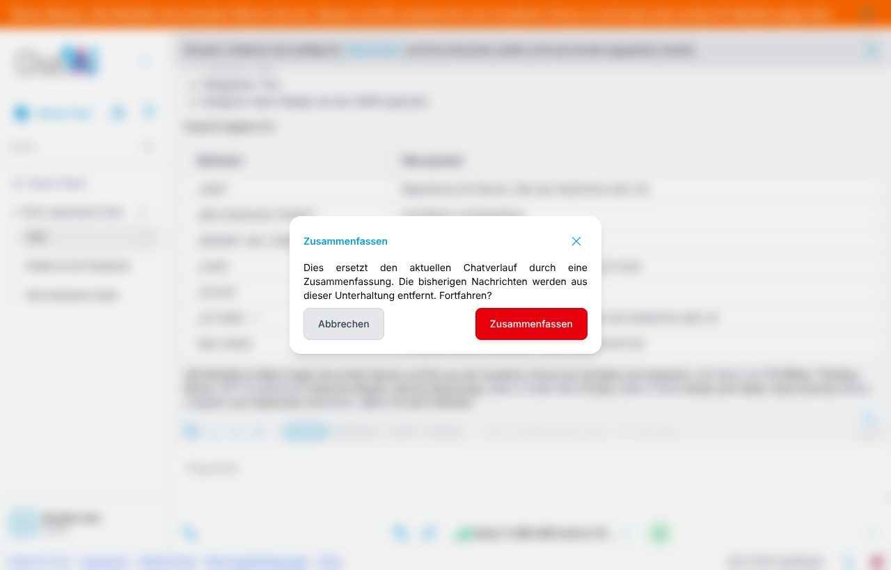

### 26 Chat löschen

Entfernt einen Chat endgültig aus dem Browser.

- **So erreichst du es:** Chat-Menü → **Löschen** und bestätigen.
- **Code:** `front/src/components/Sidebar/Modals/DeleteChatModal.jsx`

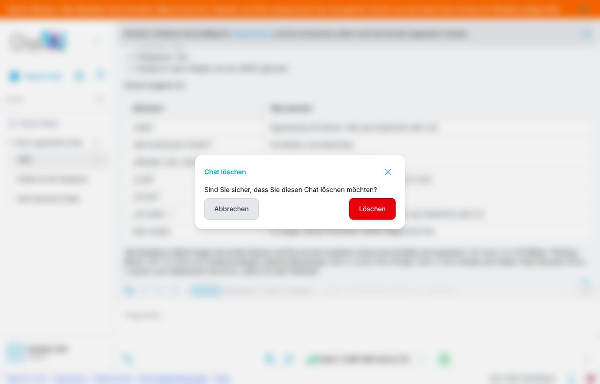

### 27 Thema erstellen

Legt ein Thema (Ordner) für zusammengehörige Chats an, mit Name, Farbe und Symbol; Beispiele wie Hausaufgaben oder Forschung helfen beim Benennen.

- **So erreichst du es:** In der Seitenleiste **Neues Thema**; Farbe und Symbol über **Symbol wählen**.
- **Code:** `front/src/components/Sidebar/TopicCreateBubble.tsx`

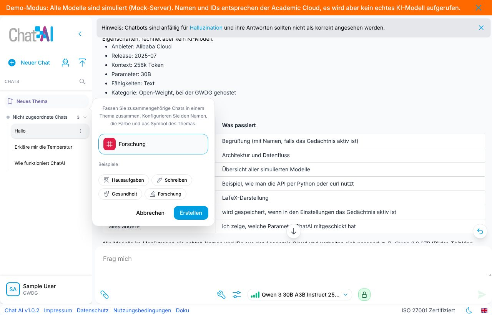

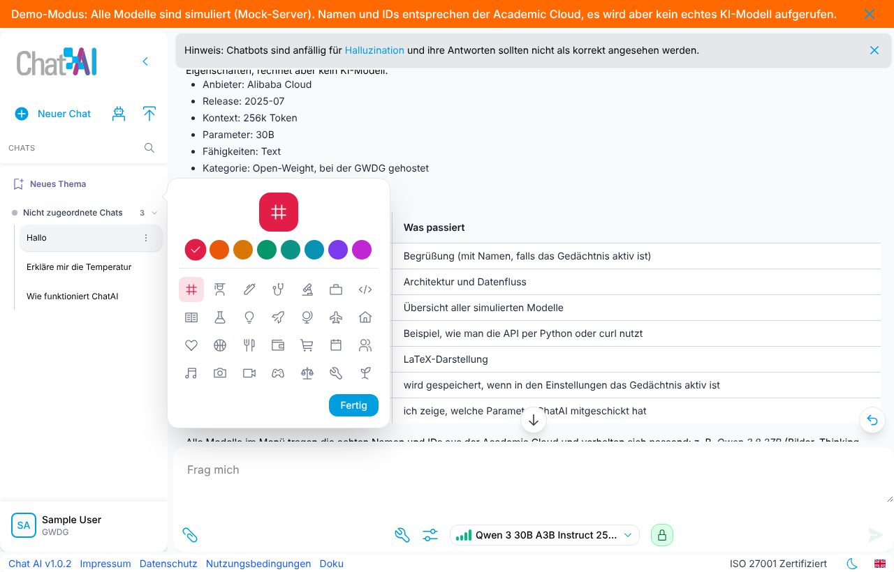

### 28 Themen auf- und zuklappen

Themen gruppieren die Chats in der Seitenleiste und lassen sich auf- und zuklappen. Chats ohne Thema stehen unter **Nicht zugeordnete Chats**.

- **So erreichst du es:** Auf die Kopfzeile eines Themas tippen; innerhalb eines Themas gibt es eigene Schaltflächen für Neuer Chat, Persona und Import.
- **Code:** `front/src/components/Sidebar/TopicList.tsx`

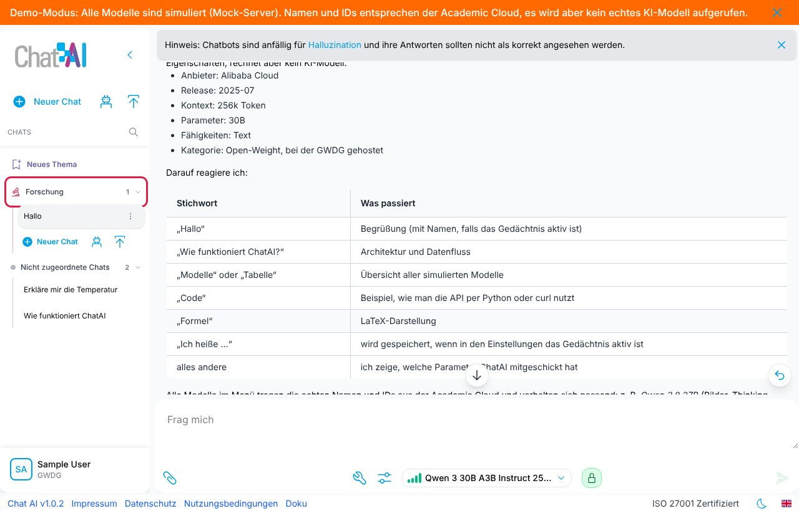

### 29 Thema umbenennen

Ändert Name, Farbe und Symbol eines Themas.

- **So erreichst du es:** Maus über das Thema bewegen → **Thema umbenennen**.
- **Code:** `front/src/components/Sidebar/Modals/FolderEditorModal.jsx`

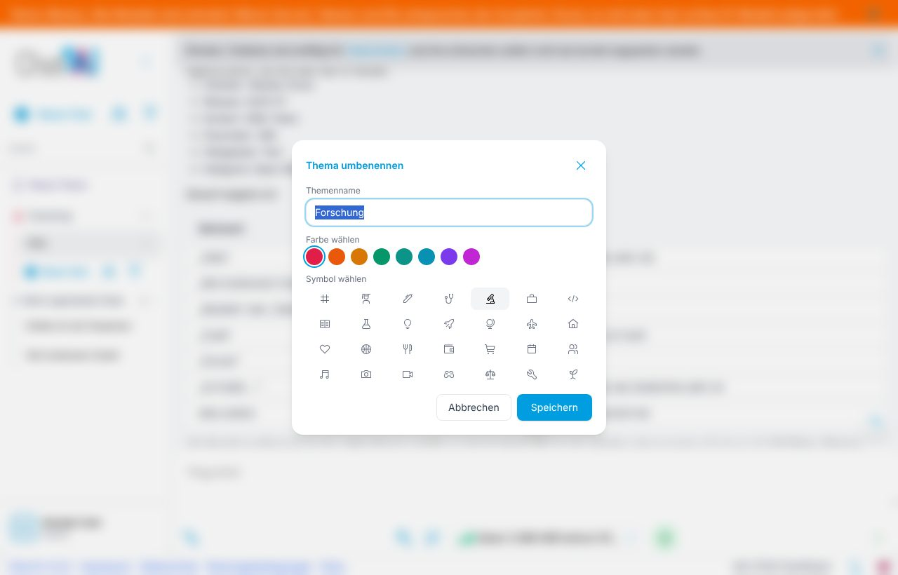

### 30 Thema löschen

Löscht ein Thema; die enthaltenen Chats bleiben erhalten und wandern zu **Nicht zugeordnete Chats**.

- **So erreichst du es:** Maus über das Thema bewegen → **Thema löschen**.
- **Code:** `front/src/components/Sidebar/Modals/DeleteFolderModal.jsx`

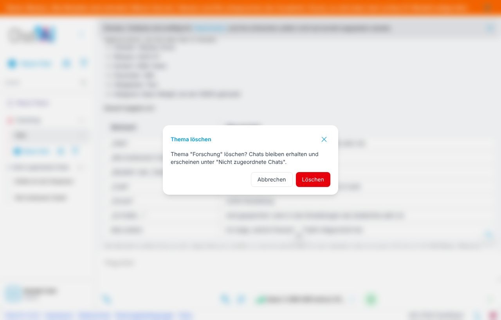

### 31 Benutzerkarte

Zeigt Name und Organisation und öffnet die Benutzereinstellungen.

- **So erreichst du es:** Unten in der Seitenleiste auf den Namen tippen.
- **In der Demo:** Zeigt den Platzhalter-Nutzer „Sample User“ aus dem Backend.
- **Code:** `front/src/components/Sidebar/SidebarUserCard.jsx`

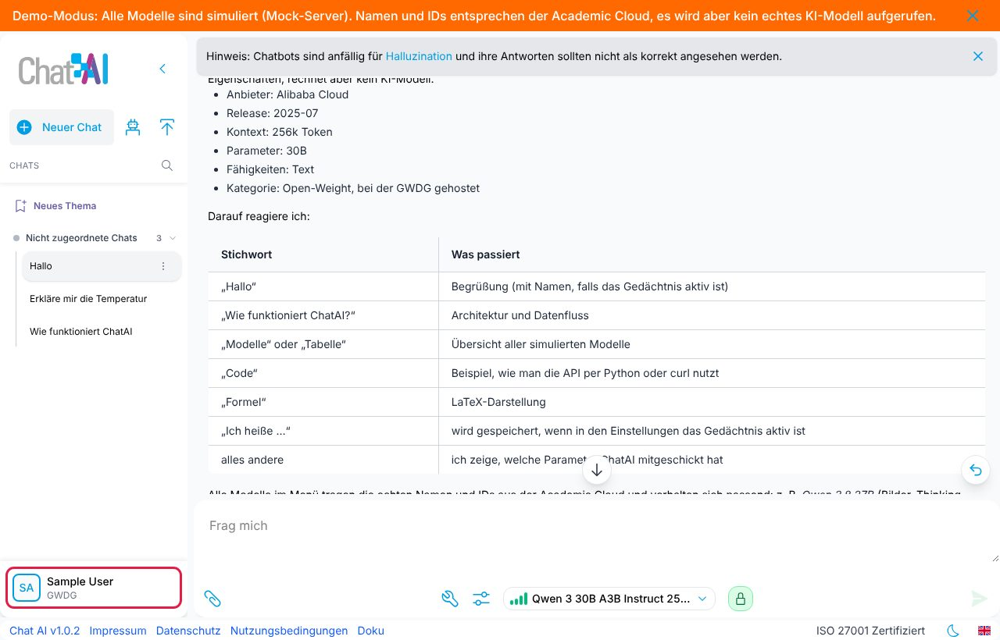

### 32 Seitenleiste auf dem Smartphone

Auf schmalen Bildschirmen öffnet sich die Seitenleiste als Schublade über dem Chat.

- **So erreichst du es:** Oben links auf das **Menü**-Symbol tippen.
- **Code:** `front/src/components/Header/HamburgerMenu.tsx`

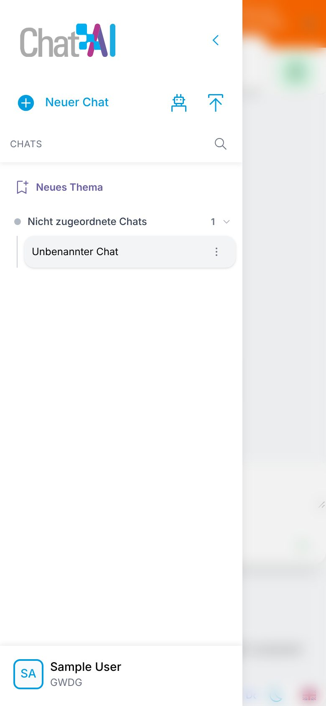

### 33 Nutzungsanzeige

Balken für **Monatliche Nutzung** und **Nutzung des Organisationsbudgets** unten in der Seitenleiste.

- **So erreichst du es:** Benutzereinstellungen → Profil → **Nutzung in der Seitenleiste anzeigen**.
- **Voraussetzung:** Braucht Kontingentdaten vom GWDG-Gateway. Das Demo-Backend liefert keine, deshalb bleibt die Anzeige leer.
- **Code:** `front/src/modals/UserSettings/UserLimitsDisplay.jsx`

## Unterhaltung & Antworten

Wie Chat AI Antworten darstellt und was man mit einzelnen Nachrichten tun kann.

### 34 Leerer Chat

Ein neuer Chat zeigt das Logo und den Hinweis, dass Gespräche nie auf den Servern gespeichert werden.

- **So erreichst du es:** **Neuer Chat** öffnen.
- **Code:** `front/src/components/Conversation/EmptyConversation.jsx`

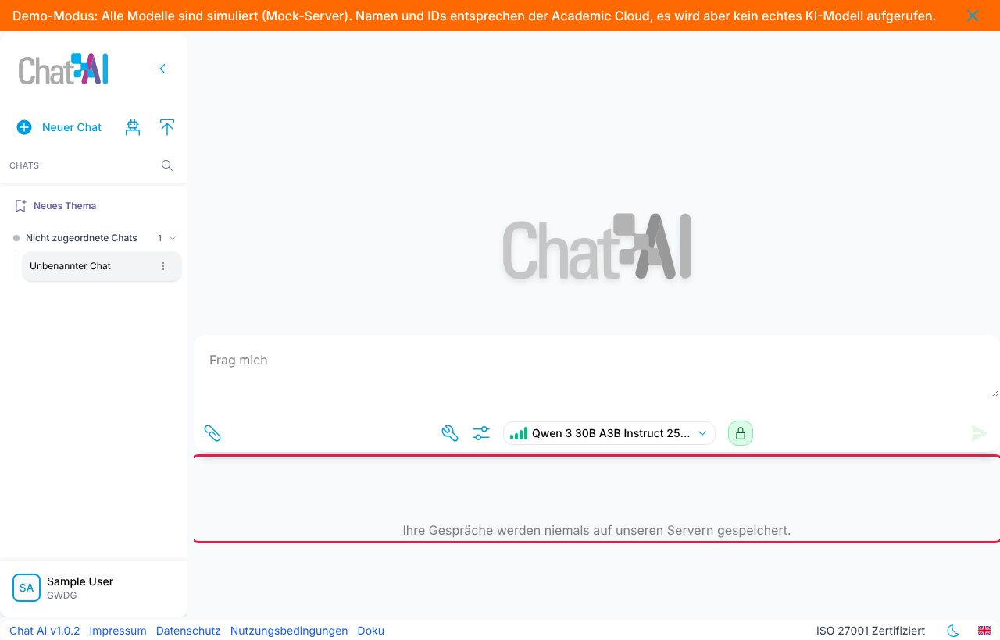

### 35 Halluzinations-Hinweis

Ein grauer Balken erinnert daran, dass Chatbots halluzinieren können, mit Link zur Erklärung.

- **So erreichst du es:** Oben über den Nachrichten; mit dem **X** schließen, nach dreimaligem Schließen bleibt er weg.
- **Code:** `front/src/components/Conversation/HallucinationWarning.jsx`

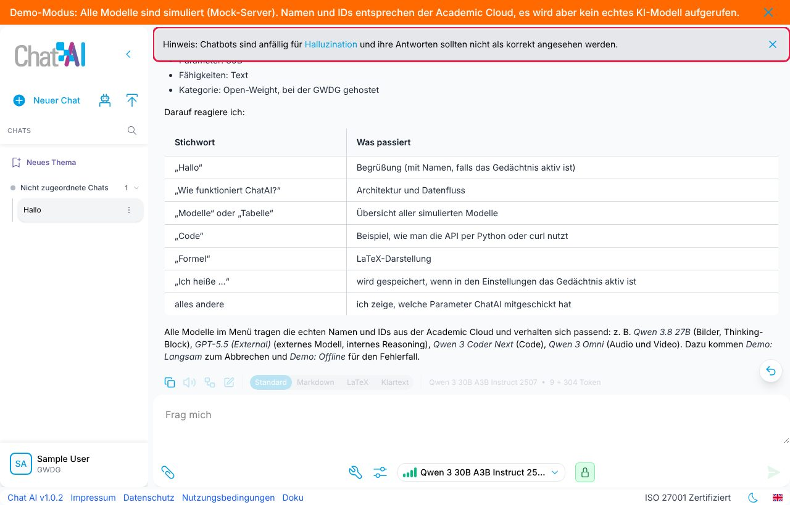

### 36 Antwort im Stream

Antworten erscheinen Wort für Wort, während das Modell rechnet; vorher zeigen drei Punkte, dass gewartet wird.

- **So erreichst du es:** Nachricht senden.
- **In der Demo:** **Demo: Langsam** streamt absichtlich langsam.
- **Code:** `front/src/utils/sendMessage.jsx`

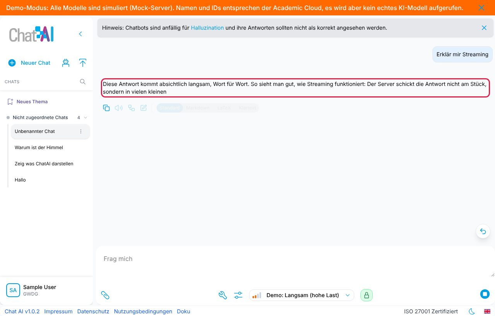

### 37 Denkprozess

Bei Reasoning-Modellen erscheint der Denkweg in einem aufklappbaren Block **Denkprozess** über der Antwort. Auch die Schritte der GWDG-Werkzeuge stehen dort.

- **So erreichst du es:** Auf **Denkprozess** über der Antwort tippen.
- **In der Demo:** Der Denkprozess ist simuliert, z. B. bei **Qwen 3.8 27B** oder **Claude Sonnet 5 (External)**.
- **Code:** `front/src/components/Conversation/MessageAssistant/ThinkingBlock.jsx`

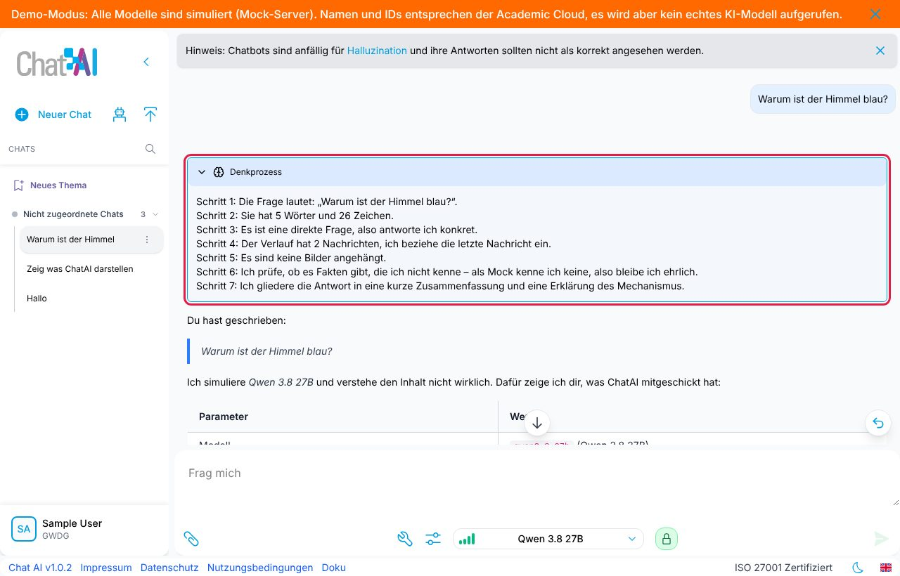

### 38 Markdown, Tabellen und Code

Antworten werden formatiert dargestellt: Überschriften, Listen, Tabellen und Code mit Syntaxhervorhebung. Codeblöcke haben oben rechts ein Kopier-Symbol.

- **So erreichst du es:** Erscheint automatisch in jeder Antwort.
- **In der Demo:** **Demo: Markdown-Showcase** zeigt alle Elemente auf einmal.
- **Code:** `front/src/components/Conversation/MessageAssistant/MarkdownRenderer.jsx`

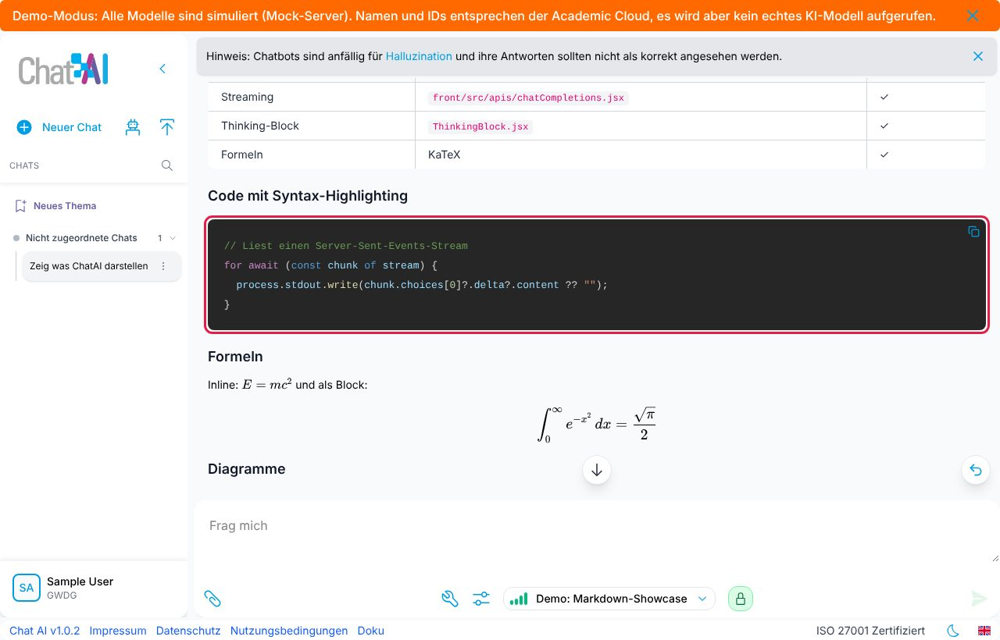

### 39 Mathematische Formeln

LaTeX-Formeln werden mit KaTeX gesetzt, inline und als Block.

- **So erreichst du es:** Erscheint automatisch in Antworten mit Formeln.
- **Code:** `front/src/components/Conversation/MessageAssistant/MarkdownRenderer.jsx`

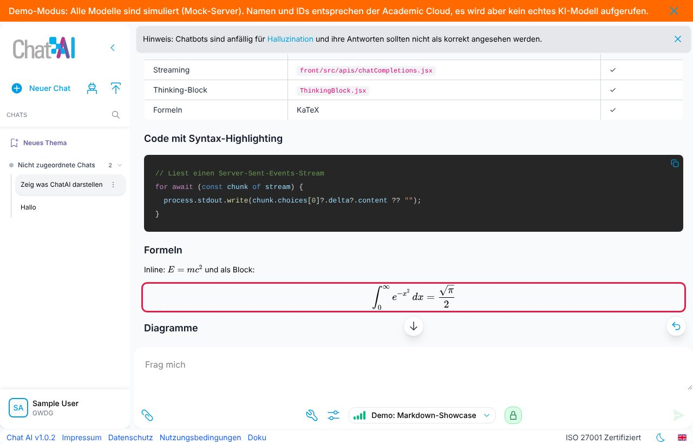

### 40 Mermaid-Diagramme

Diagramme im Mermaid-Format werden als Grafik gezeichnet.

- **So erreichst du es:** Erscheint automatisch, wenn eine Antwort einen Mermaid-Codeblock enthält.
- **In der Demo:** Der Markdown-Showcase der Demo enthält ein Beispieldiagramm. In diesem Repo behoben: Im Original blieben die Kästen leer, weil die SVG-Bereinigung die Beschriftungen entfernte.
- **Code:** `front/src/components/Conversation/MessageAssistant/MermaidDiagram.jsx`

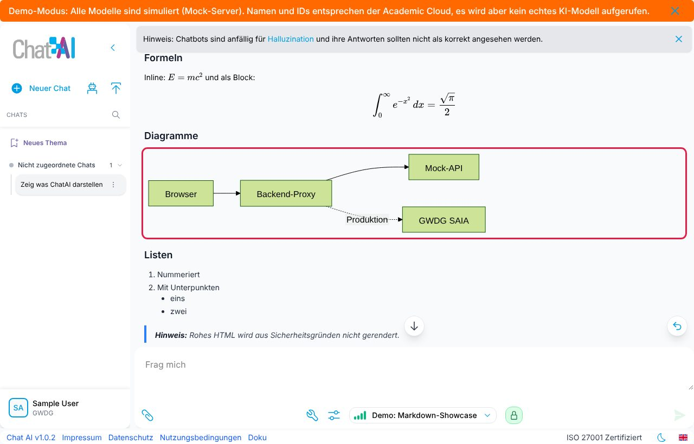

### 41 Quellen und Referenzen

Nach einer Websuche oder Arcana-Abfrage listet ein eigener Bereich die verwendeten Quellen, einzeln kopier- und aufklappbar.

- **So erreichst du es:** Unter der Antwort: **Quellen und Referenzen**.
- **In der Demo:** Die simulierte Websuche liefert Platzhalter-Quellen auf example.org.
- **Code:** `front/src/components/Conversation/MessageAssistant/ReferencesSection.jsx`

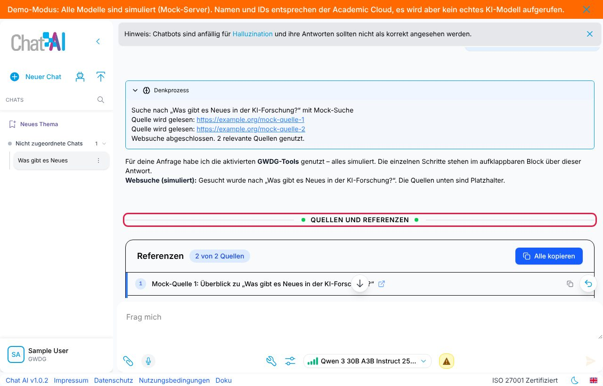

### 42 Antwort kopieren

Kopiert den Text einer Antwort in die Zwischenablage.

- **So erreichst du es:** Unter der Antwort auf **Nachricht kopieren**.
- **Code:** `front/src/components/Conversation/MessageAssistant/CopyButton.jsx`

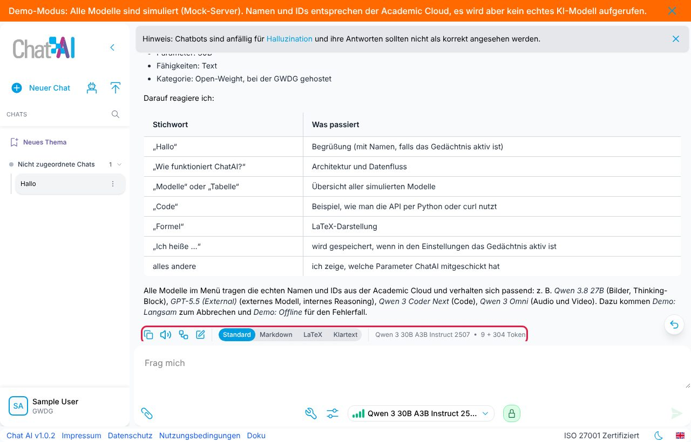

### 43 Vorlesen

Lässt eine Antwort per Sprachausgabe vorlesen; während der Wiedergabe wird das Symbol zu **Stopp**.

- **So erreichst du es:** Unter der Antwort auf **Vorlesen** (Lautsprecher).
- **Voraussetzung:** Nur wenn das Sprachmodul in der Konfiguration aktiv ist.
- **In der Demo:** Statt einer Stimme erklingt ein Ton pro Wort. In diesem Repo behoben: Im Original brach das Vorlesen bei längeren Texten ab.
- **Code:** `front/src/components/Conversation/MessageAssistant/SpeakButton.jsx`

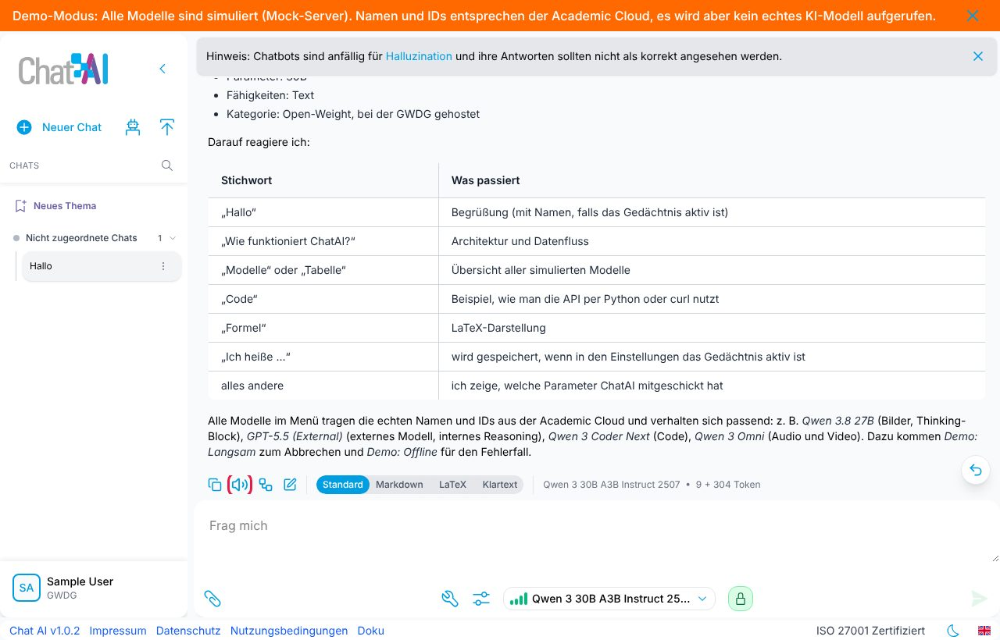

### 44 In neuem Chat fortfahren

Kopiert den Verlauf bis zu dieser Nachricht in einen neuen Chat, um von dort aus eine andere Richtung einzuschlagen.

- **So erreichst du es:** Unter einer Nachricht auf **In neuem Chat fortfahren**, dann **Kopie erstellen**.
- **Code:** `front/src/hooks/useForkConversation.jsx`

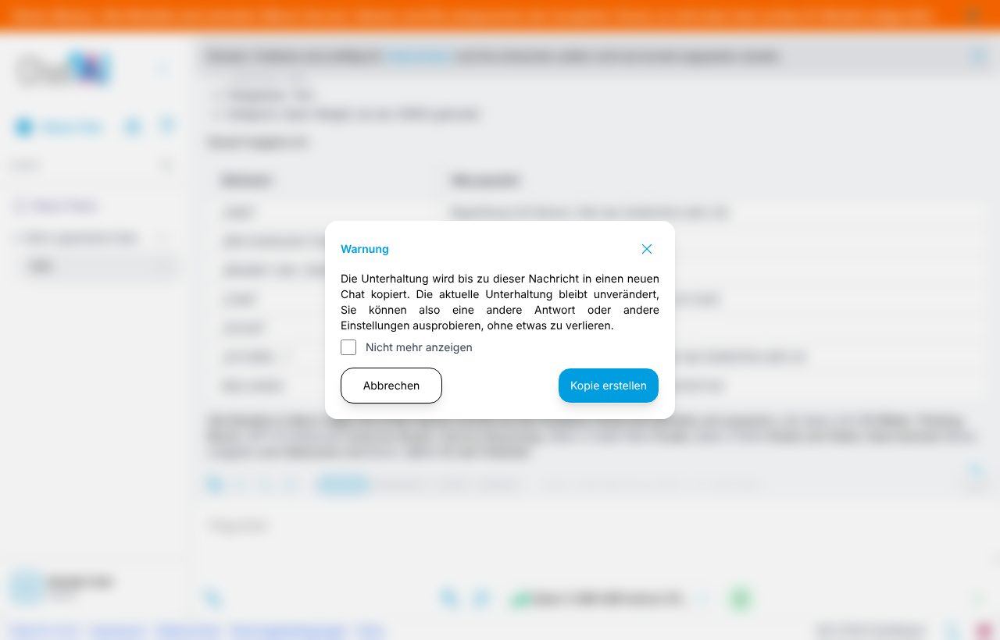

### 45 Antwort bearbeiten

Erlaubt, den Text einer Antwort nachträglich zu ändern, etwa um ihn als Grundlage für die nächste Frage zu korrigieren.

- **So erreichst du es:** Unter der Antwort auf **Nachricht bearbeiten**, ändern und speichern.
- **Code:** `front/src/components/Conversation/MessageAssistant/MessageAssistant.jsx`

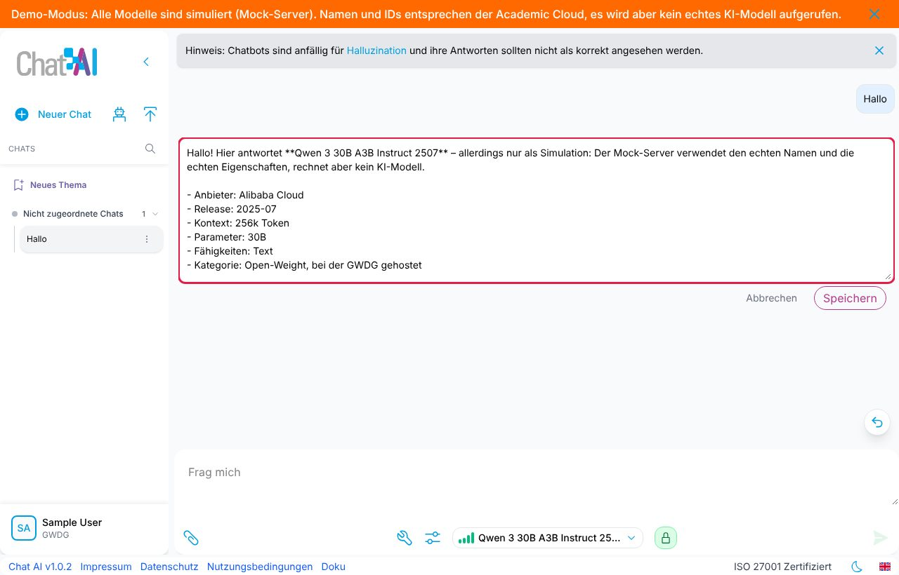

### 46 Darstellungsmodus

Schaltet die Anzeige einer Antwort zwischen **Standard**, **Markdown**, **LaTeX** und **Klartext** um, z. B. um den Rohtext zu sehen.

- **So erreichst du es:** Unter der Antwort die Umschalter **Standard | Markdown | LaTeX | Klartext** (ab 768 px Breite).
- **Code:** `front/src/components/Conversation/MessageAssistant/MessageAssistant.jsx`

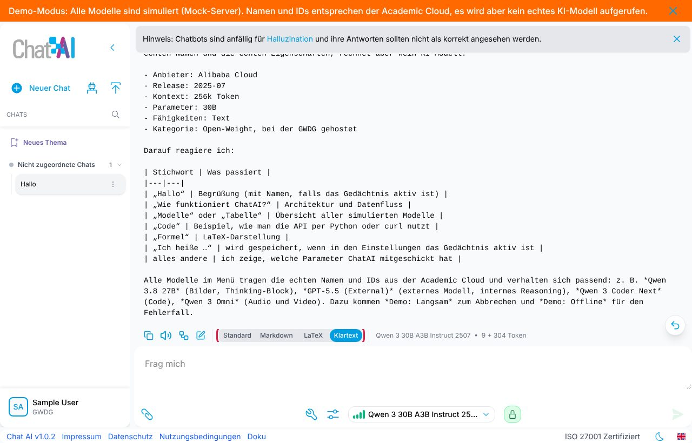

### 47 Modell und Token-Verbrauch

Rechts unter jeder Antwort steht, welches Modell geantwortet hat und wie viele **Token** Anfrage und Antwort verbraucht haben.

- **So erreichst du es:** Unter der Antwort rechts, z. B. „Qwen 3 30B A3B Instruct 2507 • 9 + 304 Token“.
- **In der Demo:** Die Token-Zahlen schätzt der Mock-Server.
- **Code:** `front/src/components/Conversation/MessageAssistant/MetaBox.jsx`

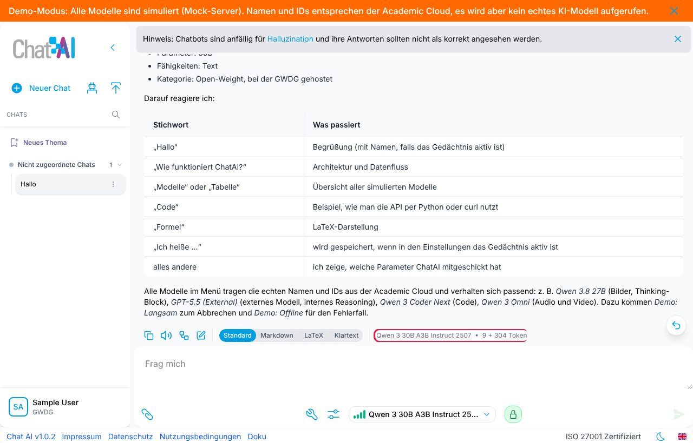

### 48 Antwort neu generieren

Schickt die eigene Frage erneut und ersetzt die Antwort darunter. Eine Rückfrage lässt sich mit **Nicht mehr anzeigen** abschalten.

- **So erreichst du es:** Maus über die eigene Nachricht → **Antwort neu generieren**, dann **Regenerieren**.
- **Code:** `front/src/components/Conversation/MessageUser/RetryButton.jsx`

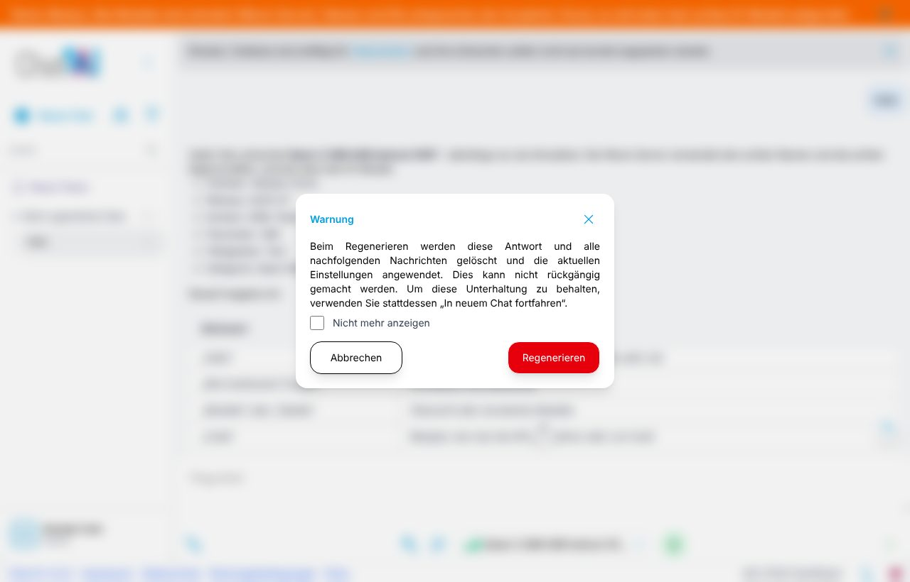

### 49 Eigene Nachricht bearbeiten

Ändert eine bereits gesendete Frage und schickt sie neu ab.

- **So erreichst du es:** Maus über die eigene Nachricht → Stift-Symbol (**Nachricht bearbeiten**); Enter speichert, Esc bricht ab.
- **Code:** `front/src/components/Conversation/MessageUser/EditBox.jsx`

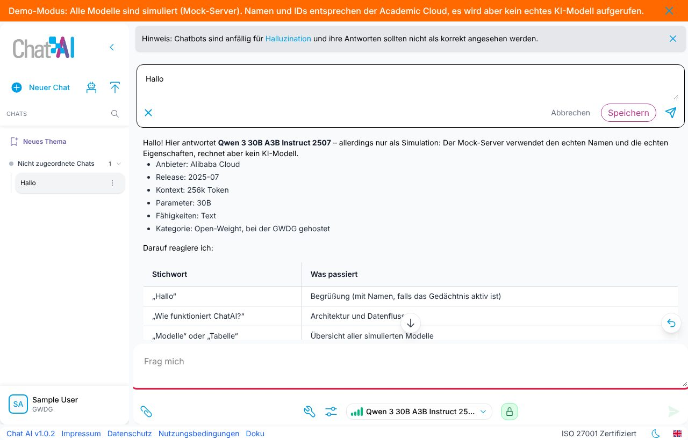

### 50 Aktionen an der eigenen Nachricht

Neben der eigenen Nachricht stehen **Antwort neu generieren**, **In neuem Chat fortfahren**, **Nachricht bearbeiten** und **Nachricht kopieren**.

- **So erreichst du es:** Maus über die eigene Nachricht bewegen.
- **Code:** `front/src/components/Conversation/MessageUser/MessageUser.jsx`

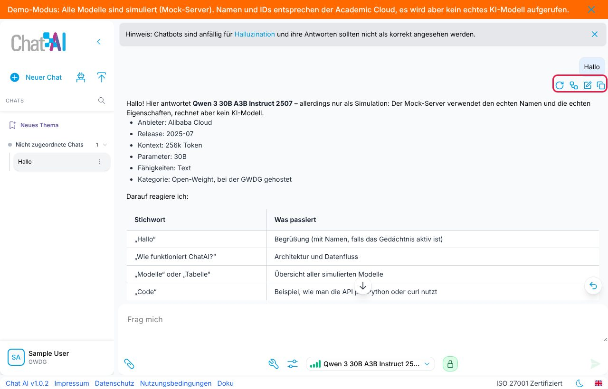

### 51 Anhänge im Verlauf und Dateivorschau

Gesendete Dateien erscheinen als Karten unter der Nachricht. Ein Klick öffnet eine Vorschau für Bilder, PDFs, Tabellen, Text und Audio mit **Auf Gerät speichern**.

- **So erreichst du es:** Auf eine Anhangkarte im Verlauf tippen.
- **Code:** `front/src/modals/Chat/PreviewModal.jsx`

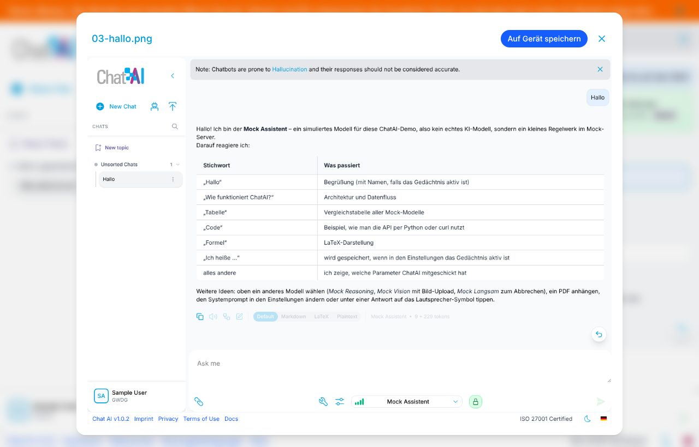

### 52 Fehlermeldung und erneut versuchen

Schlägt eine Anfrage fehl, steht der Fehler rot im Chat, darunter **Erneut versuchen**.

- **So erreichst du es:** Erscheint automatisch bei einem Fehler.
- **In der Demo:** Ausgelöst mit **Demo: Offline**.
- **Code:** `front/src/components/Conversation/MessageAssistant/MessageAssistant.jsx`

### 53 Nach unten scrollen

Eine runde Schaltfläche springt zum Ende eines langen Chats.

- **So erreichst du es:** Erscheint, wenn man im Chat nach oben gescrollt hat (**Nach unten scrollen**).
- **Code:** `front/src/components/Conversation/Conversation.jsx`

### 54 Rückgängig

Entfernt die letzte Frage samt Antwort.

- **So erreichst du es:** Runde Schaltfläche rechts über dem Eingabefeld (**Rückgängig**).
- **Code:** `front/src/components/Conversation/UndoButton.jsx`

### 55 Feedback zu Antworten

Daumen hoch, Daumen runter und ein Kommentarfeld, um Antworten zu bewerten.

- **So erreichst du es:** Unter jeder Antwort.
- **Voraussetzung:** Nur wenn das Feedback-Modul aktiv ist. In der Demo ist es aus, weil es Daten an den Betreiber sendet.
- **Code:** `front/src/components/Conversation/MessageAssistant/FeedbackButtons.jsx`

## Eingabe & Anhänge

Fragen schreiben, Dateien und Sprache anhängen, senden und abbrechen.

### 56 Eingabefeld

Hier schreibt man die Frage. Enter sendet, Shift+Enter macht eine neue Zeile. Bilder lassen sich einfügen, Dateien per Drag & Drop ablegen (**Hier ablegen**).

- **So erreichst du es:** Unten in der Mitte, Platzhalter **Frag mich**.
- **Code:** `front/src/components/Prompt/PromptTextArea.jsx`

### 57 Eingabe löschen

Leert das Eingabefeld mit einem Klick.

- **So erreichst du es:** Das runde **X** oben rechts im Eingabefeld (**Löschen**), sobald Text eingegeben ist.
- **Code:** `front/src/components/Prompt/ClearButton.jsx`

### 58 Datei anhängen

Hängt Dokumente, Bilder, Tabellen oder Audiodateien an die nächste Nachricht an.

- **So erreichst du es:** Büroklammer links in der Eingabeleiste (**Datei anhängen**).
- **Code:** `front/src/components/Prompt/AttachButton.jsx`

### 59 Anhänge-Leiste

Zeigt die angehängten Dateien als Karten mit Vorschau. Einzelne Dateien entfernt **Datei entfernen**, alle **Alle löschen**. Passt eine Datei nicht zum Modell, steht das auf der Karte.

- **So erreichst du es:** Erscheint über dem Eingabefeld, sobald etwas angehängt ist (**Anhänge**).
- **Code:** `front/src/components/Prompt/AttachmentsContainer.jsx`

### 60 PDF und Word verarbeiten

PDF- und DOCX-Dateien müssen vor dem Senden mit **Verarbeiten** in Text umgewandelt werden; danach hängt Chat AI sie als Markdown an.

- **So erreichst du es:** Auf der Anhangkarte **Verarbeiten** tippen.
- **In der Demo:** Der Mock-Server spielt Docling und liest den Text einfacher PDFs aus. In diesem Repo behoben: Im Original schlug die Verarbeitung ohne GWDG-Gateway immer fehl.
- **Code:** `front/src/components/Prompt/Attachment.jsx`

### 61 Spracheingabe

Nimmt eine Sprachnachricht auf; Klicken startet und stoppt, Gedrückthalten nimmt nur während des Haltens auf. Die Aufnahme wird als Audiodatei angehängt und bei Bedarf transkribiert.

- **So erreichst du es:** Mikrofon-Symbol in der Eingabeleiste (**Aufnehmen (klicken/halten)**).
- **Voraussetzung:** Nur bei Modellen mit Audioeingabe oder eingeschalteten Werkzeugen. Braucht die Freigabe des Mikrofons im Browser.
- **In der Demo:** Die Transkription ist simuliert.
- **Code:** `front/src/components/Prompt/MicButton.jsx`

### 62 Senden

Schickt die Nachricht ab. Grün bei sicherer Verarbeitung, gelb, wenn Daten die GWDG verlassen können.

- **So erreichst du es:** Pfeil rechts in der Eingabeleiste (**Senden**).
- **Code:** `front/src/components/Prompt/SendButton.jsx`

### 63 Antwort abbrechen

Stoppt eine laufende Antwort; der bis dahin angekommene Text bleibt stehen.

- **So erreichst du es:** Während des Streamings ersetzt **Abbrechen** (Quadrat) den Senden-Pfeil.
- **In der Demo:** Gut zu zeigen mit **Demo: Langsam**.
- **Code:** `front/src/components/Prompt/AbortButton.jsx`

### 64 Eingabe auf dem Smartphone

Auf dem Smartphone rückt die Eingabeleiste zusammen; die Modellauswahl sitzt dann in der Kopfzeile.

- **So erreichst du es:** Unter 768 px Breite.
- **Code:** `front/src/components/Prompt/Prompt.jsx`

## GWDG-Werkzeuge

Zusatzfunktionen, die auf GWDG-Servern laufen: Websuche, Bild- und Audiogenerierung, Wissensdatenbanken und mehr.

### 65 Werkzeuge öffnen und einschalten

Ein Schalter aktiviert die Werkzeuge für den Chat; darunter wählt man die einzelnen Werkzeuge als Kacheln aus.

- **So erreichst du es:** Schraubenschlüssel in der Eingabeleiste (**GWDG-Werkzeuge**), dann Schalter **Werkzeuge sind deaktiviert** umlegen.
- **Voraussetzung:** Nur wenn das Werkzeug-Modul aktiv ist. Bei externen Modellen ist der Schalter gesperrt.
- **Code:** `front/src/components/SettingsPanel/ToolsContainer.jsx`

### 66 Websuche

Lässt das Modell aktuelle Informationen im Internet suchen. Beim ersten Einschalten erklärt ein Hinweis, dass Suchanfragen an eine Suchmaschine gehen.

- **So erreichst du es:** In den GWDG-Werkzeugen die Kachel **Websuche**, Hinweis mit **Ich verstehe** bestätigen.
- **In der Demo:** Suche und Quellen sind simuliert.
- **Code:** `front/src/components/SettingsPanel/ToolsContainer.jsx`

### 67 Bildgenerierung

Erzeugt Bilder aus einer Beschreibung; das Bild hängt als Datei an der Antwort.

- **So erreichst du es:** Kachel **Bildgenerierung** (standardmäßig aktiv), dann z. B. „Erstelle ein Bild von einem Leuchtturm“.
- **In der Demo:** Statt eines Bildmodells erzeugt der Mock-Server eine Grafik mit dem Prompt.
- **Code:** `front/src/utils/sendMessage.jsx`

### 68 Bildbearbeitung

Verändert ein angehängtes Bild nach einer Textanweisung.

- **So erreichst du es:** Kachel **Bildbearbeitung** (standardmäßig aktiv), Bild anhängen und Änderung beschreiben.
- **In der Demo:** Die Bearbeitung selbst simuliert der Mock-Server nicht.
- **Code:** `front/src/components/SettingsPanel/ToolsContainer.jsx`

### 69 Audiogenerierung

Erzeugt Audio aus einer Beschreibung; die Datei hängt an der Antwort und lässt sich direkt abspielen.

- **So erreichst du es:** Kachel **Audiogenerierung** (standardmäßig aktiv), dann z. B. „Erstelle einen kurzen Klang“.
- **In der Demo:** Der Mock-Server erzeugt einen Ton pro Wort.
- **Code:** `front/src/utils/sendMessage.jsx`

### 70 Videogenerierung

Gibt Videos in Auftrag; eine **Videogenerierungs-Warteschlange** zeigt laufende und fertige Aufträge zum Herunterladen.

- **So erreichst du es:** Kachel **Videogenerierung** einschalten.
- **In der Demo:** Die Demo meldet, dass Videogenerierung nicht verfügbar ist; die Warteschlange bleibt leer.
- **Code:** `front/src/components/SettingsPanel/VideoList.jsx`

### 71 Arcana (Wissensdatenbank)

Bindet eine eigene Wissensdatenbank (Arcana aus dem RAG-Manager) ein, aus der das Modell antwortet. Ein Hinweis empfiehlt dafür niedrige Temperatur und top_p.

- **So erreichst du es:** Kachel **Arcana** (standardmäßig aktiv), dann die **Arcana-ID** eintragen.
- **In der Demo:** Ohne echte Dokumente; die Abfrage wird nur angedeutet.
- **Code:** `front/src/components/SettingsPanel/ArcanaContainer.jsx`

### 72 MCP-Server

Verbindet einen MCP-Server, dessen Werkzeuge das Modell aufrufen kann. Ein Datenschutzhinweis warnt vor externen Servern.

- **So erreichst du es:** Kachel **MCP-Server**, dann die **Server-ID** eintragen.
- **In der Demo:** Der Aufruf wird nur angedeutet.
- **Code:** `front/src/components/SettingsPanel/MCPContainer.jsx`

## Chat-Einstellungen

Einstellungen, die nur für den aktuellen Chat gelten.

### 73 Chat-Einstellungen öffnen

Öffnet die Einstellungen des aktuellen Chats.

- **So erreichst du es:** Regler-Symbol in der Eingabeleiste (**Chat-Einstellungen**).
- **Code:** `front/src/components/SettingsPanel/SettingsContent.jsx`

### 74 Temperatur

Steuert, wie zufällig das Modell formuliert: links **Logisch**, rechts **Kreativ** (0 bis 2).

- **So erreichst du es:** Chat-Einstellungen → Schieberegler **temp**.
- **Code:** `front/src/components/SettingsPanel/TemperatureSlider.jsx`

### 75 top_p

Begrenzt die Wortauswahl auf die wahrscheinlichsten Kandidaten: links **Fokussiert**, rechts **Vielfältig** (0 bis 1).

- **So erreichst du es:** Chat-Einstellungen → Schieberegler **top_p**.
- **Code:** `front/src/components/SettingsPanel/TopPSlider.jsx`

### 76 Reasoning-Aufwand

Legt fest, wie gründlich ein Reasoning-Modell nachdenkt, je nach Modell von **Aus** über **Niedrig**, **Mittel** und **Hoch** bis **Maximal**.

- **So erreichst du es:** Chat-Einstellungen → Bereich **Reasoning**.
- **Voraussetzung:** Nur bei Modellen mit Reasoning-Konfiguration in front/src/config/models/.
- **Code:** `front/src/components/SettingsPanel/ReasoningEffortContainer.jsx`

### 77 System-Prompt

Gibt dem Modell eine Grundanweisung für den ganzen Chat, z. B. eine Rolle oder einen Stil. Ist das Feld leer, warnt ein Hinweis.

- **So erreichst du es:** Chat-Einstellungen → Feld **System-Prompt**.
- **Code:** `front/src/components/SettingsPanel/SystemPromptContainer.jsx`

### 78 Einstellungen teilen

Erzeugt einen Link mit Modell, System-Prompt und Reglern des Chats, den man weitergeben kann; Arcana und MCP lassen sich gezielt einschließen.

- **So erreichst du es:** Chat-Einstellungen → **Teilen**.
- **Code:** `front/src/modals/Chat/ShareSettingsModal.jsx`

### 79 Standard zurücksetzen

Setzt Modell, Regler und System-Prompt auf die Standardwerte zurück.

- **So erreichst du es:** Chat-Einstellungen → **Standard zurücksetzen**.
- **Code:** `front/src/components/SettingsPanel/SettingsContent.jsx`

### 80 Datenschutz-Warnung in den Einstellungen

Ist der Chat so eingestellt, dass Daten die GWDG verlassen können, steht oben in den Einstellungen ein gelber Hinweis.

- **So erreichst du es:** Chat-Einstellungen bei externem Modell oder aktiver Websuche.
- **Code:** `front/src/components/Header/WarningExternalModel.tsx`

## Benutzereinstellungen & Gedächtnis

Einstellungen für alle Chats auf diesem Gerät, das Gedächtnis und die eigenen Daten.

### 81 Profil

Zeigt Name, Organisation, Benutzername und E-Mail sowie die Nutzung; ein Schalter blendet die Nutzung in der Seitenleiste ein. Hier liegt auch **Abmelden**.

- **So erreichst du es:** Benutzerkarte unten in der Seitenleiste → Reiter **Profil**.
- **In der Demo:** Zeigt den Platzhalter-Nutzer des Demo-Backends; Abmelden führt zum GWDG-Login und funktioniert in der Demo nicht.
- **Code:** `front/src/modals/UserSettings/UserInfoContainer.jsx`

### 82 Standardmodell

Legt fest, mit welchem Modell neue Chats starten.

- **So erreichst du es:** Benutzereinstellungen → Reiter **Chat** → **Standardmodell**.
- **Code:** `front/src/modals/UserSettings/DefaultModelSelector.jsx`

### 83 Wartezeit für Antworten

Bestimmt, wie lange Chat AI auf eine Antwort wartet (5 bis 900 Sekunden).

- **So erreichst du es:** Benutzereinstellungen → Reiter **Chat** → **Wartezeit für Antworten**.
- **Code:** `front/src/modals/UserSettings/TimeoutSetter.jsx`

### 84 Folgevorschläge

Zeigt nach jeder Antwort anklickbare Vorschläge für die nächste Frage.

- **So erreichst du es:** Benutzereinstellungen → Reiter **Chat** → **Folgevorschläge anzeigen**.
- **Voraussetzung:** Nur wenn das Modul für Vorschläge aktiv ist. In der Demo ist es aus.
- **Code:** `front/src/components/Prompt/PromptTextArea.jsx`

### 85 Gedächtnis-Modus

Bestimmt, ob Chat AI sich Dinge über den Nutzer merkt: **Keine** (aus), **Abrufen** (gespeicherte Erinnerungen nutzen) oder **Lernen** (zusätzlich Neues speichern).

- **So erreichst du es:** Benutzereinstellungen → Reiter **Erinnerungen**.
- **Code:** `front/src/modals/UserSettings/ChatPreferences.jsx`

### 86 Gedächtnis im Chat

Im Modus **Lernen** speichert Chat AI persönliche Angaben wie den Namen und nutzt sie in späteren Chats.

- **So erreichst du es:** „Ich heiße …“ schreiben, dann einen neuen Chat öffnen und „Hallo“ sagen.
- **In der Demo:** Das simulierte Modell erkennt einfache Sätze wie „Ich heiße …“ oder „Ich wohne in …“.
- **Code:** `front/src/apis/generateMemory.jsx`

### 87 Erinnerungen verwalten

Listet alle gespeicherten Erinnerungen; man kann neue hinzufügen, einzelne bearbeiten oder löschen.

- **So erreichst du es:** Reiter **Erinnerungen** → **Erinnerungen verwalten**.
- **Code:** `front/src/modals/UserSettings/UserMemoryModal.jsx`

### 88 Alle Erinnerungen löschen

Löscht alle Erinnerungen auf einmal nach einer Rückfrage.

- **So erreichst du es:** In **Erinnerungen verwalten** → **Alle löschen**.
- **Code:** `front/src/modals/UserSettings/ClearMemoryModal.jsx`

### 89 Daten importieren und exportieren

Sichert alle lokalen Daten (Chats, Themen, Einstellungen) als JSON-Datei oder spielt eine Sicherung wieder ein.

- **So erreichst du es:** Benutzereinstellungen → Reiter **Daten** → **Daten exportieren** bzw. **Daten importieren**.
- **Code:** `front/src/modals/UserSettings/UserSettingsModal.jsx`

### 90 Daten löschen

Löscht alle Chats und Einstellungen im Browser nach einer Rückfrage.

- **So erreichst du es:** Reiter **Daten** → **Daten löschen**, dann **Ja, alles löschen**.
- **Code:** `front/src/modals/UserSettings/ClearCacheModal.jsx`

## Hilfen, Hinweise & Dialoge

Erklärfenster, Rückmeldungen und Dialoge für Sonderfälle.

### 91 Hilfe-Fenster

Fragezeichen-Symbole öffnen kurze Erklärungen zu Temperatur, top_p, Reasoning, System-Prompt, Werkzeugen, Arcana, MCP, Gedächtnis und Folgevorschlägen.

- **So erreichst du es:** Auf das **?** neben der jeweiligen Einstellung tippen.
- **Code:** `front/src/modals/Help/`

### 92 Importierte Einstellungen prüfen

Öffnet man einen geteilten Einstellungs-Link mit Websuche oder MCP, fragt Chat AI nach, welche dieser Optionen übernommen werden sollen.

- **So erreichst du es:** Einen Link mit `?settings=…` öffnen, der Websuche oder MCP enthält; **Erlauben** oder **Nicht erlauben**.
- **Code:** `front/src/modals/Alert/ImportSettingsDisclaimerModal.jsx`

### 93 Kurzmeldungen

Kleine Meldungen oben rechts bestätigen Aktionen wie Kopieren, Export oder Zusammenfassen oder melden Fehler.

- **So erreichst du es:** Erscheinen automatisch und verschwinden nach kurzer Zeit.
- **Code:** `front/src/hooks/useToast.jsx`

### 94 Sitzung abgelaufen

Ist die Anmeldung abgelaufen, fordert ein Fenster zum **Aktualisieren** der Seite auf.

- **So erreichst du es:** Erscheint automatisch, wenn der Server die Anmeldung ablehnt.
- **Voraussetzung:** Nur mit echter GWDG-Anmeldung; die Demo hat keine Sitzung, die ablaufen kann.
- **Code:** `front/src/modals/Alert/ErrorSessionExpiredModal.jsx`

### 95 Bearbeitungskonflikt

Wurde derselbe Chat in einem anderen Tab geändert, fragt Chat AI, ob neu geladen oder überschrieben werden soll (**Neu laden** / **Überschreiben**).

- **So erreichst du es:** Erscheint automatisch beim Speichern.
- **Voraussetzung:** Nur bei gleichzeitiger Bearbeitung desselben Chats in zwei Tabs; nicht für einen Screenshot nachgestellt.
- **Code:** `front/src/modals/Chat/ConversationConflict.jsx`

### 96 Datenmigration

Nach einem großen Update bietet ein Fenster an, alte Daten zu sichern und in das neue Format zu übernehmen.

- **So erreichst du es:** Erscheint automatisch, wenn Daten aus einer alten Version vorhanden sind.
- **Voraussetzung:** Nur bei vorhandenen Daten aus einer älteren Chat-AI-Version.
- **Code:** `front/src/modals/Alert/MigrateDataModal.jsx`

### 97 Nicht erreichbare Funktionen im Code

Einige Teile sind im Code vorhanden, werden in Version 1.0.2 aber nirgends angezeigt: **Medien anhängen**, die Hilfen zu Modellen und zur Websuche, die Fenster für fehlerhafte Anfragen, nicht gesendete und nicht verarbeitete Dateien sowie ältere Schaltflächen zum Leeren und Exportieren eines Chats.

- **Voraussetzung:** Im Code registriert, aber von keiner Stelle der Oberfläche aufgerufen.
- **Code:** `front/src/components/Prompt/AttachMediaButton.jsx`

## Fußzeile, Tour & Seiten

Einstieg, Darstellung, Sprache und die Seiten außerhalb des Chats.

### 98 Willkommensfenster

Beim ersten Besuch begrüßt ein Fenster die Nutzer und bietet eine geführte Tour an.

- **So erreichst du es:** Erscheint automatisch; **Tour starten** oder **Tour überspringen**.
- **Code:** `front/src/modals/Help/WelcomeModal.jsx`

### 99 Geführte Tour

Sechs Schritte erklären Eingabe, Modellauswahl, Chat-Liste, Profil, Chat-Einstellungen und Darstellung.

- **So erreichst du es:** Im Willkommensfenster **Tour starten**; mit **Weiter**, **Zurück** und **Überspringen** steuern.
- **Code:** `front/src/components/SettingsPanel/TourManager.jsx`

### 100 Fußzeile

Unten stehen Version (mit Link zum Quellcode), **Impressum**, **Datenschutz**, **Nutzungsbedingungen**, **Doku** und der Hinweis **ISO 27001 Zertifiziert**.

- **So erreichst du es:** Unterer Rand der Seite.
- **In der Demo:** Impressum und Datenschutz verweisen auf die Seiten der GWDG.
- **Code:** `front/src/components/Footer/CollapsibleFooter.tsx`

### 101 Dunkelmodus

Schaltet zwischen heller und dunkler Darstellung um.

- **So erreichst du es:** Mond- bzw. Sonnensymbol rechts in der Fußzeile.
- **Code:** `front/src/components/Header/ThemeToggle.jsx`

### 102 Sprache umschalten

Wechselt die Oberfläche zwischen Deutsch und Englisch; die Wahl wird im Browser gespeichert.

- **So erreichst du es:** Flagge ganz rechts in der Fußzeile; sie zeigt jeweils die andere Sprache.
- **In der Demo:** In dieser Demo ist Deutsch voreingestellt (`defaultLanguage` in `front.json`). Hart codierte englische Texte des Originals sind übersetzt.
- **Code:** `front/src/components/Footer/LanguageSelector.jsx`

### 103 Chat per Link vorkonfigurieren

Über Parameter in der Adresse lassen sich Modell, Werkzeuge, Arcana, Sprache oder geteilte Einstellungen vorgeben, z. B. `?model=qwen3.8-27b` oder `?lng=de`; `?import=` lädt einen Chat aus einer URL.

- **So erreichst du es:** Adresse mit Parametern aufrufen.
- **Code:** `front/src/hooks/useSyncConversation.ts`

### 104 Seite „Unterhaltung nicht gefunden“

Bei einem ungültigen Chat-Link erscheint eine Fehlerseite mit **Zum Chat gehen**.

- **So erreichst du es:** Adresse `/notfound` oder einen nicht vorhandenen Chat aufrufen.
- **Code:** `front/src/Pages/NotFoundPage.jsx`

### 105 Anmeldeseite

Nicht angemeldete Nutzer sehen eine Seite mit **Anmelden mit AcademicCloud SSO**.

- **So erreichst du es:** Adresse `/landing`.
- **In der Demo:** Die Anmeldung selbst ist in der Demo nicht angebunden.
- **Code:** `front/src/Pages/LandingPage.jsx`

### 106 Titel im Browser-Tab

Der Browser-Tab zeigt den Titel des geöffneten Chats, z. B. „Hallo - Chat AI“.

- **So erreichst du es:** Im Tab des Browsers.
- **Voraussetzung:** Liegt außerhalb der Seite und ist daher nicht im Screenshot zu sehen.
- **Code:** `front/src/hooks/useTabTitle.jsx`

---

Alle Screenshots stammen aus der Demo mit simulierten Modellen; Antworten, Token-Zahlen, Quellen und Nutzerdaten sind Demo-Werte. Funktionen, die auf GWDG-Infrastruktur angewiesen sind (Anmeldung, Nutzungskontingente, Arcana, MCP, Personas von GitHub), sind nur so weit gezeigt, wie die Demo sie nachbilden kann.
